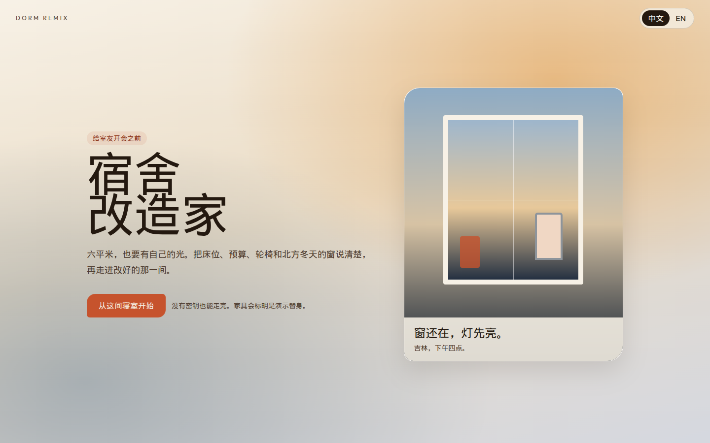
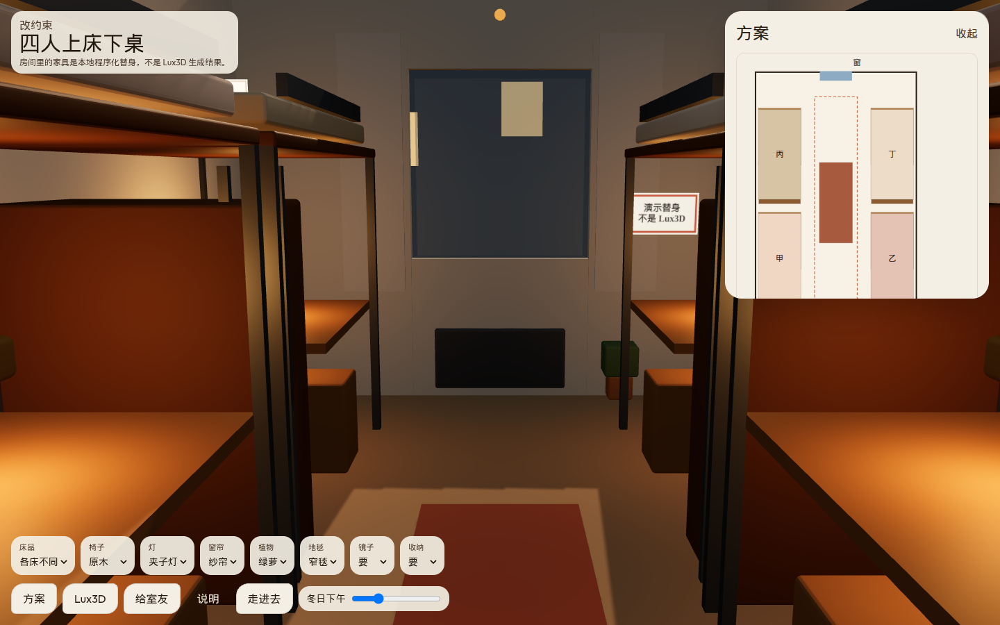
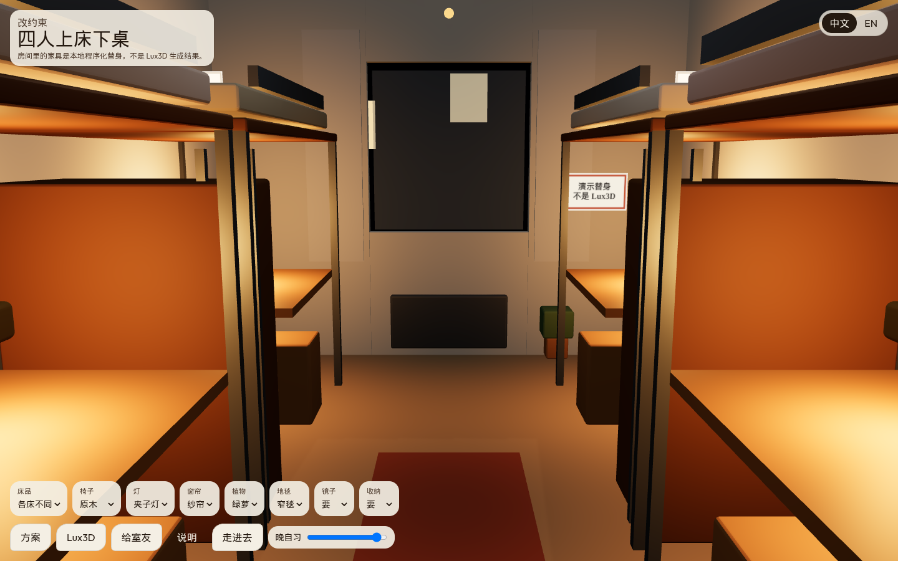
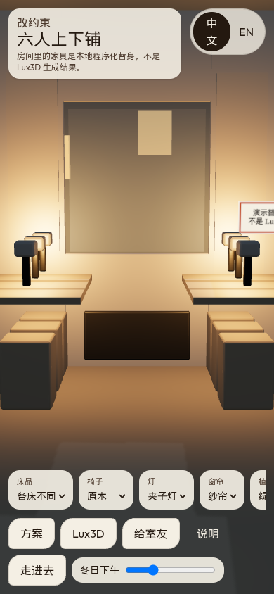

# 宿舍改造家 · Dorm Remix

给中国高校学生用的寝室改造网页。把床位、预算、轮椅和北方冬天的窗说清楚，再走进改好的那一间，换家具，导出一套图给室友开会。

A dorm-planning web app for Chinese university students. State the beds, the budget, a wheelchair, and a northern winter window, then walk through the result, swap furniture, and export pictures for a roommate meeting.

团队 / team: **宿舍改造家** · 团队码 / team code `3FO4K4W3AXYC` · 王丽（学生，单人）

本仓库按 **2026-11-17** 抓取的官网规则制作：[aholo.ai/hackathon](https://www.aholo.ai/hackathon) 与 [aholo.cn/hackathon](https://www.aholo.cn/hackathon)。没有调用真实 Lux3D，也没有消耗积分。









更多截图在 [`docs/shots/`](docs/shots/)。

## 本地运行

需要 Node.js 22。

```bash
npm install
npm run dev
```

打开 [http://127.0.0.1:47321](http://127.0.0.1:47321)。

```bash
npm test          # 方案计算与 Lux3D 适配器
npm run lint
npm run build     # 静态文件在 dist/
npm run preview   # 同样带本地 Lux3D 代理，端口 47321
```

静态站点不包含密钥代理。页面发现 `/api/health` 不存在时，自动停在演示模式。

## 中文说明

### 产品在做什么

学生填写入住卡：房型（四人上床下桌、双人上床下桌、四人上下铺、六人上下铺、单人间）、在住人数、预算、窗朝向、校园气候（吉林一带 / 其他北方 / 其他）、材料气质，以及是否有人需要轮椅。也可以上传一张参考照片。照片只在这台设备上取色。若另外填了公网 `https` 图片地址，直播模式会把这个地址写进**椅子**那一条文生三维的 `img` 字段，不会把整间寝室假装成一次图生三维。

方案会留下 0.9 米过道，把衣柜让开窗区，并按预算先买灯、再考虑纱帘、镜子、植物、收纳和地毯。吉林或北向下午几乎没有直射，灯优先于装饰。上床下桌没有下铺：无障碍说明会写明“人还是得爬上去睡”，不会把它说成验收通过。空床的架子保留，桌面当公共收纳。

走进房间之后可以环视或用 WASD / 手机圆垫走动，拖动时间从冬日下午到晚自习，替换床品、椅子、灯、窗帘等。导出的讨论图下面会烧上诚实说明。

没有 WebGL 时，同一套方案仍以平面图和文字给出。

### Lux3D 用在哪

Lux3D 负责**单体家具**，不负责整间房子的墙和钢架。墙、过道和上下铺位置是可测试的布局代码；床架、椅子、台灯、绿萝、收纳箱、窗帘各有一条符合官方 OpenAPI 的 `TextTo3dRequest`。

演示模式：

- 房间里的牌子写着「演示替身 / 不是 Lux3D」。
- 资产面板展示将要提交的请求体。
- 折叠区里的任务号（例如创建响应 `1256173`、成功查询 `1389515`）来自官方 OpenAPI 示例，标注了来源和抓取日期，**不是这次寝室的生成结果**。
- 没有密钥时，代理返回 `DEMO_MODE`，不会编造响应。

直播模式（本机有密钥时）：

1. 浏览器只访问同源的 `/api/lux3d/*`，密钥留在开发服务器。
2. `POST /global/lux3d/v1/generate/text-to-3d/task/create`，请求头是 `Authorization: <key>`，没有 `Bearer`。
3. `GET /global/lux3d/v1/generate/task/get?taskid=` 轮询。状态 `0/1` 继续，`3` 成功，`4` 失败，`6` 取消。
4. 官方错误码 `GENERATION_CONCURRENCY_LIMIT_EXCEEDED` 表示同一时间只能有一个生成任务，所以队列是串行的，间隔默认 12 秒。
5. G1 成功时按扩展名取出 GLB（文档顺序是 ZIP、GLB，请求了 PLY 时再跟 PLY）。`NOT_REQUESTED` 会丢掉。
6. GLB 由本机代理下载后再给页面，避免结果链接的跨域问题。结果链接大约 2 小时失效。

也可以把提示词复制到 Lux3D 网页，再把 GLB 的 `https` 地址贴回来。这种模型标成「外部链接，来源未核验」，不会写成已验证的 Lux3D 任务。

图生三维路由 `POST /global/lux3d/v1/generate/img-to-3d/task/create` 已接上，要求 `img` 与 `imgs` 二选一。参考图必须是不带账号密码的 `https` 地址；本地上传不会被当成生成结果。

Aholo Viewer（`@manycore/aholo-viewer`）只用于打开文档中的官方示例 `bear.sog`。那个示例不是寝室。宿舍走看用的是网格。世界生成 / 3DGS 壳层如果以后要接，应使用 World API 的 splat，而不是把 Lux3D 的网格 PLY 塞进 Viewer。

### 架构

```text
入住卡 Brief
    → planDorm()                纯函数：尺寸、过道、预算、警告、Lux3D 提示词
    → 演示场景                    Three.js 程序化替身，牌子写明不是 Lux3D
    → 直播代理 server/plugin.ts  只在 npm run dev / preview
         → Lux3dClient           https://api.aholo.ai 或 https://api.aholo.cn
         → 轮询 taskid → GLB
    → 讨论图                     画布截图 + 烧录说明
```

| 路径 | 作用 |
| --- | --- |
| `src/lib/planner/` | 房型、预算、冬季光线、无障碍、提示词 |
| `src/lib/lux3d/` | OpenAPI 类型、官方示例、解析、队列、演示/直播边界 |
| `server/plugin.ts` | 开发服务器上的同源代理，密钥不出浏览器 |
| `src/components/` | 中文优先界面、三维房间、平面图、Viewer 示例 |

### 凭证

复制 `.env.example` 为 `.env`。不要把 `.env` 提交进仓库，也不要使用 `VITE_` 前缀，否则密钥会被打进静态页面。

| 变量 | 含义 |
| --- | --- |
| `AHOLO_API_KEY` | [labs.aholo.ai/api-keys](https://labs.aholo.ai/api-keys) 或中国区控制台的密钥 |
| `AHOLO_REGION` | `com` → `https://api.aholo.ai`；`cn` → `https://api.aholo.cn`（与 TypeScript SDK 的 region 说明一致）。OpenAPI 文档公布的服务器是全球网关 |
| `AHOLO_API_BASE` | 可选，仅 `https` 源站。路径仍是 `/global/lux3d/v1/...` |
| `LUX3D_VERSION` | `G1`（默认）或 `G1-Turbo` |
| `LUX3D_FACE_COUNT` | `10000`–`300000`，产品默认 `120000` |

改完 `.env` 后重启 `npm run dev`。页面上的「用 Lux3D 生成这些件」会先确认，因为这会按顺序消耗积分。

### 静态托管

`npm run build` 的 `base` 是相对路径，可放到 GitHub Pages 或其他静态空间，不依赖 Vercel。构建产物里没有密钥。演示模式在 Pages 上可以直接走完。

真人还要做的事写在 [`docs/HUMAN_STEPS.md`](docs/HUMAN_STEPS.md)。报告提纲、视频分镜和选题分别在 `docs/submission.md`、`docs/VIDEO_PLAN.md`、`docs/topic.md`。

## English

### Run

Node.js 22. `npm install`, then `npm run dev`, then open [http://127.0.0.1:47321](http://127.0.0.1:47321). `npm test` covers the planner and the Lux3D adapter. `npm run build` writes a static `dist/` that does not embed secrets. If `/api/health` is missing, the UI stays in demo mode.

### What it does

The housing card asks for room type, how many people actually live there, budget, window direction, campus climate (around Jilin, another northern campus, or elsewhere), material mood, and whether someone uses a wheelchair. A photo is sampled for color on the device only. A public `https` image URL, if provided, is attached only to the chair’s text-to-3D `img` field in live mode.

The plan keeps a 0.9 m aisle, keeps wardrobes out of the window zone, and spends money on lamps before rugs. A loft bed still means climbing; the accessible copy says so instead of claiming certification. Empty campus frames stay and become shared desk storage.

Inside the room: orbit or walk, slide from a winter afternoon to night study, swap linen and lamps, export a roommate board. Without WebGL, the same plan remains as a floor plan and text.

### How Lux3D is used

Lux3D generates **single objects**. Walls and bed frames are tested layout code. Each hero object (bed, chair, lamp, plant, crate, curtain) has a `TextTo3dRequest` shaped like the official OpenAPI.

Demo mode labels the stand-in in the room, shows the unsent request, and keeps official sample task ids (`1256173`, `1389515`, and the running/failed/concurrency examples) inside a disclosure cited to the OpenAPI file retrieved on 2026-11-17. Those samples are not this dorm. With no key, the proxy returns `DEMO_MODE` and does not invent a body.

Live mode, only when `AHOLO_API_KEY` is present on the dev server:

1. The browser calls same-origin `/api/lux3d/*`. The key is not returned by `/api/health` (`keyExposed: false`).
2. Create with `POST /global/lux3d/v1/generate/text-to-3d/task/create` and header `Authorization: <key>` (no `Bearer`).
3. Poll `GET /global/lux3d/v1/generate/task/get?taskid=`. Status `0/1` waits, `3` succeeds, `4` fails, `6` is canceled.
4. Tasks run one at a time because `GENERATION_CONCURRENCY_LIMIT_EXCEEDED` means another generation is already in progress. Default poll interval is 12 seconds.
5. A G1 success picks the `.glb` URL. `NOT_REQUESTED` is ignored. Result URLs expire in about two hours.
6. The dev server downloads that GLB and serves it same-origin.

A GLB URL pasted by hand is labeled as an external link whose origin was not verified. Image-to-3D is wired (`img` xor `imgs`, https only). Aholo Viewer loads the documented `bear.sog` sample and the dialog says it is not the dorm.

### Credentials

Copy `.env.example` to `.env`. Do not commit it. Do not use a `VITE_` prefix; the health check warns and ignores `VITE_AHOLO_API_KEY` so the key is not bundled.

| Variable | Meaning |
| --- | --- |
| `AHOLO_API_KEY` | Key from the Aholo labs console |
| `AHOLO_REGION` | `com` → `https://api.aholo.ai`; `cn` → `https://api.aholo.cn` |
| `AHOLO_API_BASE` | Optional https origin override. Paths stay `/global/lux3d/v1/...` |
| `LUX3D_VERSION` | `G1` (default) or `G1-Turbo` |
| `LUX3D_FACE_COUNT` | `10000`–`300000`, product default `120000` |

Restart `npm run dev` after editing `.env`. The generate button asks before spending credits.

### Static hosting

`vite build` uses a relative base, so `dist/` can be published on GitHub Pages or any static host. It does not depend on Vercel. Steps that only a person can do are in [`docs/HUMAN_STEPS.md`](docs/HUMAN_STEPS.md).
